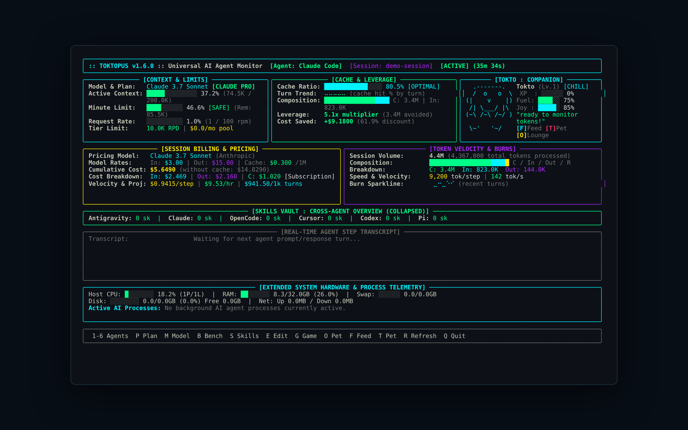
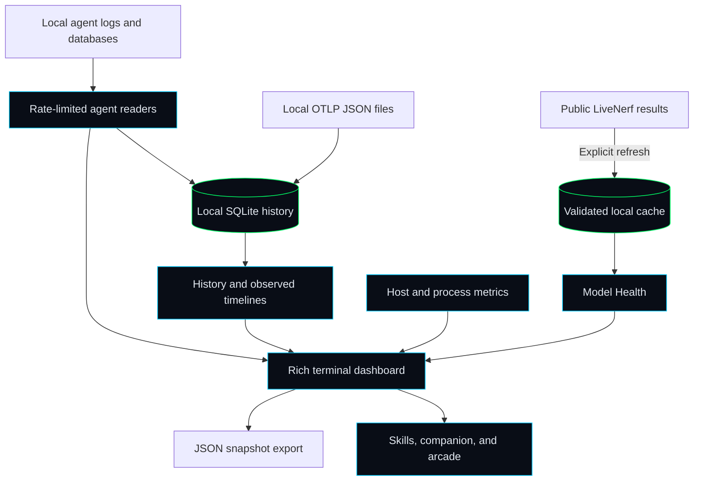
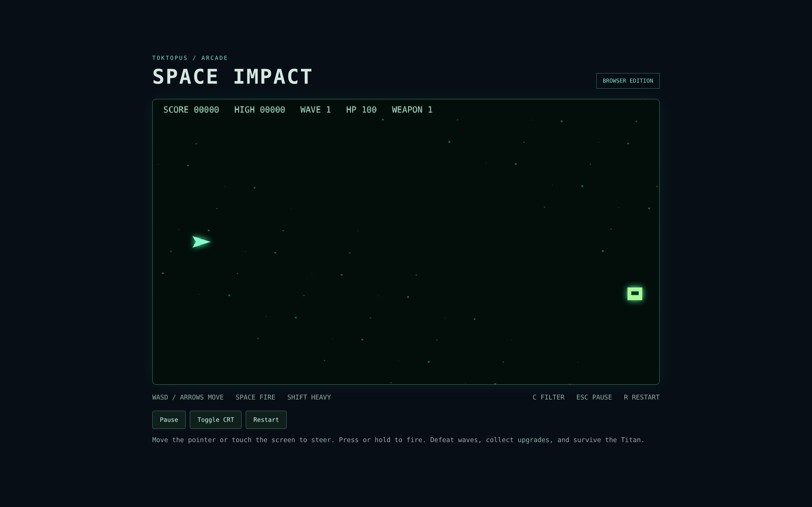

<div align="center">

# TOKTOPUS

**A local terminal dashboard for coding-agent telemetry, costs, and system activity.**

<sub>Local history. Observed tool timelines. Model health. Built for the terminal.</sub>

[](https://github.com/NadimHider/toktopus/stargazers)
[](https://github.com/NadimHider/toktopus/network/members)
[](https://github.com/NadimHider/toktopus/watchers)
[](https://github.com/NadimHider/toktopus/issues)
[](https://github.com/NadimHider/toktopus/commits/main)
[](https://github.com/NadimHider/toktopus)
[](https://github.com/NadimHider/toktopus)
[](./LICENSE)

[](https://github.com/NadimHider/toktopus/releases/latest)
[](https://github.com/NadimHider/toktopus/actions/workflows/ci.yml)
[](./pyproject.toml)


[Overview](#overview) · [Quick Start](#quick-start) · [User Guide](docs/USAGE.md) · [Model Health](#model-health) · [Architecture](#system-architecture) · [Report Issue](https://github.com/NadimHider/toktopus/issues/new?labels=bug) · [Request Feature](https://github.com/NadimHider/toktopus/issues/new?labels=enhancement)

<br />

<picture>
  <source media="(prefers-color-scheme: dark)" srcset="./assets/screenshot.png">
  <source media="(prefers-color-scheme: light)" srcset="./assets/screenshot.png">
  
</picture>

<sub>Dashboard preview from v1.6.0 with sample telemetry. Current measurement behavior is described below.</sub>

</div>

---

> [!IMPORTANT]
> Toktopus runs locally without a monitoring-service login or model calls. Costs are estimates, and account quotas remain unavailable without a verified source. Your coding agents still use their own accounts and may incur their usual charges.

## Overview

Toktopus brings your local coding-agent activity into one terminal dashboard. Follow available token usage, inspect observed tool activity, revisit recorded sessions, and watch host resources without adding a cloud monitoring stack.

Antigravity, Claude Code, OpenCode, Cursor, Codex, and legacy Pi records are supported through agent-specific readers. Source fidelity varies by agent and version. The skill vault, companion lounge, and Space Impact arcade are still part of the app.

### Core Capabilities

<table>
<tr>
<td width="50%" valign="top">
<h3>Live agent telemetry</h3>
<p>Available token counts, cache activity, model information, and estimated costs beside CPU, memory, process, disk, network, and available GPU metrics.</p>
</td>
<td width="50%" valign="top">
<h3>Local session history</h3>
<p>Persistent SQLite snapshots, metadata search, and paged navigation. Repeated polls update existing records rather than inflating totals.</p>
</td>
</tr>
<tr>
<td width="50%" valign="top">
<h3>Observed tool timelines</h3>
<p>Inspect available tool results, timestamps, failure counts, and repeated-activity hints. Import OTLP JSON to inspect span identities, parent relationships, and durations.</p>
</td>
<td width="50%" valign="top">
<h3>Model Health</h3>
<p>Public LiveNerf observations with sample counts, source provenance, explicit refresh, and a validated offline cache. No benchmark inference runs in the background.</p>
</td>
</tr>
<tr>
<td width="50%" valign="top">
<h3>Skills and diagnostics</h3>
<p>Browse installed skills and inspect local reader status. Missing sources and unsupported database schemas have a dedicated diagnostic view.</p>
</td>
<td width="50%" valign="top">
<h3>Companion and arcade</h3>
<p>Visit the companion lounge or launch Space Impact in the terminal or browser. The browser edition includes touch controls, waves, bosses, power-ups, and CRT styling.</p>
</td>
</tr>
</table>

### New in v1.7.0

Local history, selectable tool timelines, OTLP JSON imports, LiveNerf Model Health, corrected Codex accounting, and support for OpenCode's session/message/part database schema.

[Read the release notes](docs/releases/v1.7.0.md) · [Explore the full user guide](docs/USAGE.md) · [See the research and roadmap](docs/OBSERVABILITY-RESEARCH.md)

## Quick Start

Requires Python 3.9 or newer and an interactive terminal for the live dashboard and terminal game. If `toktopus` is not on PATH, use `python -m toktopus`.

```bash
git clone https://github.com/NadimHider/toktopus.git
cd toktopus
python -m pip install .
toktopus
```

```bash
toktopus --once
toktopus --export telemetry.json
toktopus --game
toktopus --web-game
python -m unittest discover -s tests
```

> [!TIP]
> Use `toktopus --once` or `--export PATH` for non-interactive jobs, and set `NO_COLOR=1` or pass `--no-color` for plain output. An export can contain session and host details; review it before sharing.

<details>
<summary><strong>Install the release, update a checkout, or use a downloaded wheel</strong></summary>

Install v1.7.0 directly from GitHub with Git available:

```bash
python -m pip install --upgrade "git+https://github.com/NadimHider/toktopus.git@v1.7.0"
python -m toktopus
```

For an existing checkout on `main`:

```bash
git pull --ff-only
python -m pip install --upgrade .
```

Prefer a downloaded package? Install the wheel from the [latest release](https://github.com/NadimHider/toktopus/releases/latest) with `python -m pip install --upgrade PATH_TO_WHEEL`.

</details>

## Local Observability

Press <kbd>J</kbd> to open History, <kbd>[</kbd> / <kbd>]</kbd> to select a session, and <kbd>Enter</kbd> to inspect its observed timeline. Use <kbd>N</kbd> / <kbd>P</kbd> to page through sessions or move to older/newer events. Press <kbd>D</kbd> for Diagnostics.

```bash
python -m toktopus --history --search codex
python -m toktopus --timeline SESSION_ID --agent codex
python -m toktopus --diagnostics --agent opencode
python -m toktopus --import-otlp trace.json
```

History records available observations while Toktopus runs. It omits prompts, tool arguments, and tool outputs. Use `--no-history` to disable recording and automatic background discovery for a run.

<details>
<summary><strong>Source coverage, storage, imports, and measurement limits</strong></summary>

- Detected local agents are checked for history every five seconds. Selected-agent telemetry is cached for two seconds.
- History retains at most 2,000 sessions and 50,000 events in `~/.config/toktopus/history.sqlite3`.
- Native tool detail has the strongest coverage in Claude Code, Codex, and the supported OpenCode database schema. Pi's current coding-agent JSONL format remains future work.
- OTLP imports accept JSON files up to 8 MB and 10,000 spans. They do not start a network collector or instrument unrelated applications.
- Timelines show recorded evidence. Polling can miss events; a repeated-activity hint does not prove the agent is stuck, and an ended turn does not prove task completion.
- Local token totals cannot establish account-wide quota or billing. Missing measurements remain unavailable.
- Retained metadata and snapshot exports can still be sensitive. Review them before sharing.

See the [user guide](docs/USAGE.md) for full source coverage, privacy details, search, paging, and import commands.

</details>

## Model Health

Follow public [LiveNerf](https://github.com/ninjahawk/livenerf) observations without running a benchmark yourself. Press <kbd>H</kbd> for the cached terminal view.

```bash
python -m toktopus --refresh-model-health
python -m toktopus --model-health
```

Refresh downloads public data only when requested. Cached viewing works offline, failed refreshes preserve the last valid copy, and retrievals older than 48 hours are marked stale. The full command-line view includes benchmark-family detail and provenance. Toktopus does not infer a statistical degradation verdict from a daily score.

## Configuration & Controls

Settings are stored in `~/.config/toktopus/config.json`. The browser game stores its own high score in browser local storage when available. Browser local-storage behavior for local files depends on the browser.

| Action / Command | Primary Trigger | Description |
| :--- | :---: | :--- |
| Select agent | <kbd>1</kbd>–<kbd>6</kbd> or `--agent NAME` | Select Antigravity, Claude, OpenCode, Cursor, Codex, or Pi; `auto` attempts detection. |
| History / timeline | <kbd>J</kbd> / <kbd>Enter</kbd> | Open History or inspect the selected session. <kbd>[</kbd> / <kbd>]</kbd> select; <kbd>N</kbd> / <kbd>P</kbd> change pages. |
| Diagnostics / Model Health | <kbd>D</kbd> / <kbd>H</kbd> | Inspect source health or cached public benchmark observations. |
| Change plan or model | <kbd>P</kbd> / <kbd>M</kbd> | In Overview, cycle legacy plan estimates or estimated pricing models. `--plan` configures an estimate; it does not verify an account. |
| Dashboard views | <kbd>B</kbd> / <kbd>S</kbd> / <kbd>E</kbd> | Toggle benchmarks, expand skills, or edit a skill. |
| Pet and arcade | <kbd>O</kbd> / <kbd>G</kbd> | Open the pet lounge or terminal game; <kbd>F</kbd> feeds and <kbd>T</kbd> pets the companion. |
| Refresh / quit | <kbd>R</kbd> / <kbd>Q</kbd> | Refresh immediately or exit. `--rate SECONDS` controls the refresh interval, default 0.3. |
| Snapshot / export | `--once` / `--export PATH` | Print one dashboard or write a JSON snapshot and exit. |
| Skills | `--skills`, `--get-skill NAME`, `--modify-skill NAME`, `--copy-skill NAME` | List, inspect, edit, or copy skills; see `toktopus --help` for required companion arguments. |
| Space Impact: Move | <kbd>W</kbd> <kbd>A</kbd> <kbd>S</kbd> <kbd>D</kbd> / <kbd>Arrows</kbd> | Move in either game edition. The browser edition also supports pointer and touch controls. |
| Space Impact: Fire | <kbd>Space</kbd> / <kbd>Shift</kbd> | Fire in either edition; <kbd>Shift</kbd> fires heavy ordnance in the browser edition. |
| Space Impact: Pause and filter | <kbd>P</kbd> / <kbd>Esc</kbd> / <kbd>C</kbd> | Terminal: <kbd>P</kbd> pauses, <kbd>Q</kbd> or <kbd>Esc</kbd> exits. Browser: <kbd>Esc</kbd> pauses and <kbd>C</kbd> toggles scanlines. <kbd>R</kbd> restarts after game over. |

Run `toktopus --help` for all flags, including `--benchmarks`, `--pet`, skill editing modes, and version information.

## System Architecture



The terminal game is entered from the dashboard or with `--game`; the standalone browser game is opened with `--web-game`. It runs in its own browser page rather than inside the Rich terminal dashboard.

<details>
<summary><strong>Space Impact: browser arcade preview</strong></summary>

<br />


Launch with `python -m toktopus --web-game`, or use <kbd>G</kbd> for the terminal edition. The browser game supports keyboard, pointer, and touch controls.

</details>

<details>
<summary><strong>Directory Structure</strong></summary>

```text
.
├── .github/workflows/         Continuous integration
├── assets/                    Dashboard and browser-game previews
├── data/                      Benchmark data
├── docs/                      User guide, release notes, and research
├── scripts/                   Platform installers
├── tests/                     Unit tests
├── toktopus/
│   ├── adapters/              Agent-specific data readers
│   ├── core/                  Collectors, history, imports, pricing, model health, and extras
│   ├── ui/                    Rich dashboard, history, timelines, and Model Health
│   ├── web/space-impact.html  Self-contained browser game
│   ├── cli.py                 CLI and terminal event loop
│   └── game.py                Terminal game
├── pyproject.toml             Package metadata and dependencies
├── LICENSE
└── README.md
```

</details>

<details>
<summary><strong>Technical Specifications</strong></summary>

| Area | Implementation |
| :--- | :--- |
| Runtime | Python 3.9+, Rich, psutil; browser edition uses Canvas and JavaScript |
| State | In-memory state, JSON configuration, SQLite history, and cached public results; browser game uses local storage |
| Rendering | Rich terminal layouts; isolated Canvas page for browser arcade |
| Scheduling | Dashboard rendering: 0.3 seconds; selected-agent cache: 2 seconds; history discovery: 5 seconds; terminal game: 0.04-second steps |
| Object limits | Browser game preallocates 160 projectile and 240 particle slots; excess effects are dropped |
| Persistence | Atomic configuration/cache writes, bounded local history, and separate terminal/browser high scores |
| Validation | 111 tests at v1.7.0 release; Ruff lint, distribution builds, and cross-platform GitHub CI |

</details>

---

<div align="center">
  <sub>Built and maintained by <a href="https://github.com/NadimHider">N4D Labs</a>.</sub>
</div>
