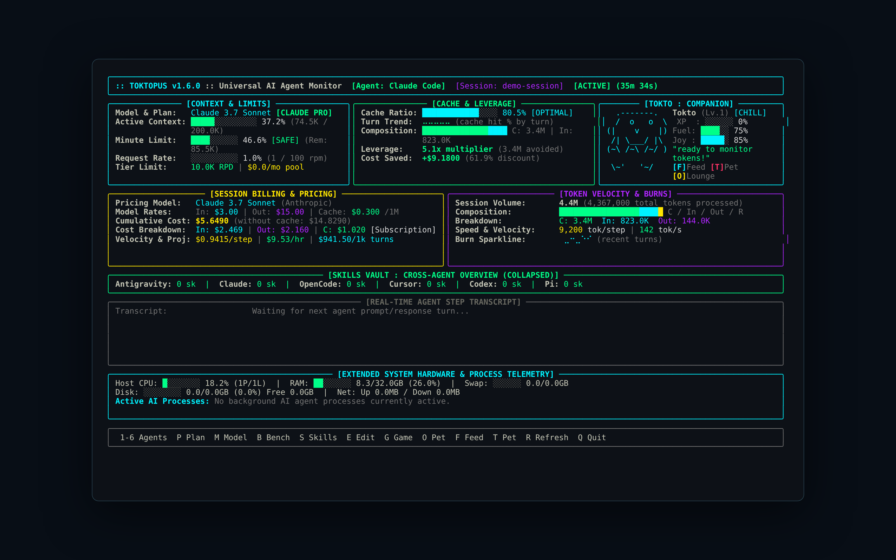
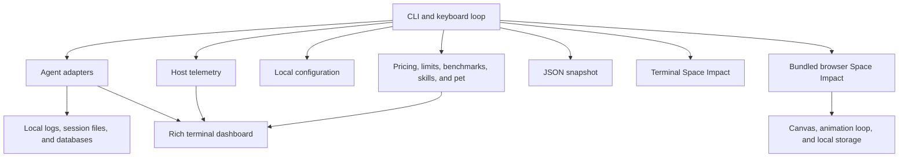

<div align="center">

# TOKTOPUS

**A local terminal dashboard for coding-agent telemetry, costs, and system activity.**

[](https://github.com/NadimHider/toktopus/stargazers)
[](https://github.com/NadimHider/toktopus/network/members)
[](https://github.com/NadimHider/toktopus/watchers)
[](https://github.com/NadimHider/toktopus/issues)
[](https://github.com/NadimHider/toktopus/commits/main)
[](https://github.com/NadimHider/toktopus)
[](https://github.com/NadimHider/toktopus)
[](./LICENSE)

[Documentation](#overview) · [Quick Start](#quick-start) · [Architecture](#system-architecture) · [Report Issue](https://github.com/NadimHider/toktopus/issues/new?labels=bug) · [Request Feature](https://github.com/NadimHider/toktopus/issues/new?labels=enhancement)

<br />

<picture>
  <source media="(prefers-color-scheme: dark)" srcset="./assets/screenshot.png">
  <source media="(prefers-color-scheme: light)" srcset="./assets/screenshot.png">
  
</picture>

</div>

---

> [!IMPORTANT]
> Toktopus normalizes locally available coding-agent telemetry through agent-specific adapters and displays it alongside host metrics. Pricing and account-limit figures are estimates based on the configured model and plan, not authoritative billing or quota data.

## Overview

Toktopus is a Python terminal application for monitoring Antigravity, Claude Code, OpenCode, Cursor, Codex, and Pi. It reads locally available session data, presents a Rich dashboard, and can export a JSON snapshot for downstream scripts. The dashboard includes a skill vault, model benchmark table, an interactive companion, and a terminal Space Impact game. A separate browser edition of the game is bundled with the package.

### Core Capabilities

- **Agent telemetry:** Agent adapters discover local sessions and normalize available token, model, and activity data into a dashboard-friendly snapshot.
- **Costs and limits:** Pricing tables and plan heuristics calculate estimated session costs, cache savings, and quota indicators. Host CPU, memory, process, disk, network, and available GPU metrics are collected with psutil and optional NVIDIA tooling.
- **Terminal workflows:** Switch agents and views interactively, inspect or modify installed skills, display benchmarks, and export snapshots as JSON.
- **Embedded arcade subsystem (Space Impact):** The terminal shooter uses a fixed-step simulation and persists its high score in the application configuration. The optional browser edition uses a delta-time animation loop, bounded projectile and particle pools, collision boxes, wave patterns, boss phases, power-ups, and a CRT-inspired canvas.

## Quick Start

Requires Python 3.9 or newer and an interactive terminal for the live dashboard and terminal game.

```bash
git clone https://github.com/NadimHider/toktopus.git
cd toktopus
python -m pip install .
toktopus
```

```bash
toktopus --once
toktopus --export telemetry.json
toktopus --game
toktopus --web-game
python -m unittest discover -s tests
```

> [!TIP]
> Use `toktopus --once` or `--export PATH` for non-interactive jobs, and set `NO_COLOR=1` or pass `--no-color` for plain output. An export can contain session and host details; review it before sharing.

## Configuration & Controls

Settings are stored in `~/.config/toktopus/config.json`. The browser game stores its own high score in browser local storage when available. Browser local-storage behavior for local files depends on the browser.

| Action / Command | Primary Trigger | Description |
| :--- | :---: | :--- |
| Select agent | <kbd>1</kbd>–<kbd>6</kbd> or `--agent NAME` | Select Antigravity, Claude, OpenCode, Cursor, Codex, or Pi; `auto` attempts detection. |
| Change plan or model | <kbd>P</kbd> / <kbd>M</kbd> | Cycle plan estimates or pricing models. `--plan` sets a plan at launch. |
| Dashboard views | <kbd>B</kbd> / <kbd>S</kbd> / <kbd>E</kbd> | Toggle benchmarks, expand skills, or edit a skill. |
| Pet and arcade | <kbd>O</kbd> / <kbd>G</kbd> | Open the pet lounge or terminal game; <kbd>F</kbd> feeds and <kbd>T</kbd> pets the companion. |
| Refresh / quit | <kbd>R</kbd> / <kbd>Q</kbd> | Refresh immediately or exit. `--rate SECONDS` controls the refresh interval, default 0.3. |
| Snapshot / export | `--once` / `--export PATH` | Print one dashboard or write a JSON snapshot and exit. |
| Skills | `--skills`, `--get-skill NAME`, `--modify-skill NAME`, `--copy-skill NAME` | List, inspect, edit, or copy skills; see `toktopus --help` for required companion arguments. |
| Space Impact: Move | <kbd>W</kbd> <kbd>A</kbd> <kbd>S</kbd> <kbd>D</kbd> / <kbd>Arrows</kbd> | Move in either game edition. The browser edition also supports pointer and touch controls. |
| Space Impact: Fire | <kbd>Space</kbd> / <kbd>Shift</kbd> | Fire in either edition; <kbd>Shift</kbd> fires heavy ordnance in the browser edition. |
| Space Impact: Pause and filter | <kbd>P</kbd> / <kbd>Esc</kbd> / <kbd>C</kbd> | Terminal: <kbd>P</kbd> pauses, <kbd>Q</kbd> or <kbd>Esc</kbd> exits. Browser: <kbd>Esc</kbd> pauses and <kbd>C</kbd> toggles scanlines. <kbd>R</kbd> restarts after game over. |

Run `toktopus --help` for all flags, including `--benchmarks`, `--pet`, skill editing modes, and version information.

## System Architecture



The terminal game is entered from the dashboard or with `--game`; the standalone browser game is opened with `--web-game`. It runs in its own browser page rather than inside the Rich terminal dashboard.

<details>
<summary><strong>Directory Structure</strong></summary>

```text
.
├── .github/workflows/         Continuous integration
├── assets/                    Dashboard and browser-game previews
├── data/                      Benchmark data
├── scripts/                   Platform installers
├── tests/                     Unit tests
├── toktopus/
│   ├── adapters/              Agent-specific data readers
│   ├── core/                  Configuration, telemetry, pricing, limits, skills, pet
│   ├── ui/                    Rich charts, layout, and theme
│   ├── web/space-impact.html  Self-contained browser game
│   ├── cli.py                 CLI and terminal event loop
│   └── game.py                Terminal game
├── pyproject.toml             Package metadata and dependencies
├── LICENSE
└── README.md
```

</details>

<details>
<summary><strong>Technical Specifications</strong></summary>

| Area | Implementation |
| :--- | :--- |
| Runtime | Python 3.9+, Rich, psutil; browser edition uses Canvas and JavaScript |
| State | In-memory application state and JSON configuration; browser game uses local storage where available |
| Rendering | Rich terminal layouts; isolated Canvas page for browser arcade |
| Scheduling | Dashboard refresh defaults to 0.3 seconds; terminal arcade uses 0.04-second simulation steps; browser arcade uses `requestAnimationFrame` with capped delta time |
| Object limits | Browser game preallocates 160 projectile and 240 particle slots; excess effects are dropped |
| Persistence | Configuration is replaced atomically; terminal and browser high scores are stored separately |
| Validation | Standard-library `unittest` suite; build with `python -m build` after installing `build` |

</details>

---

<div align="center">
  <sub>Built and maintained by <a href="https://github.com/NadimHider">N4D Labs</a>.</sub>
</div>
